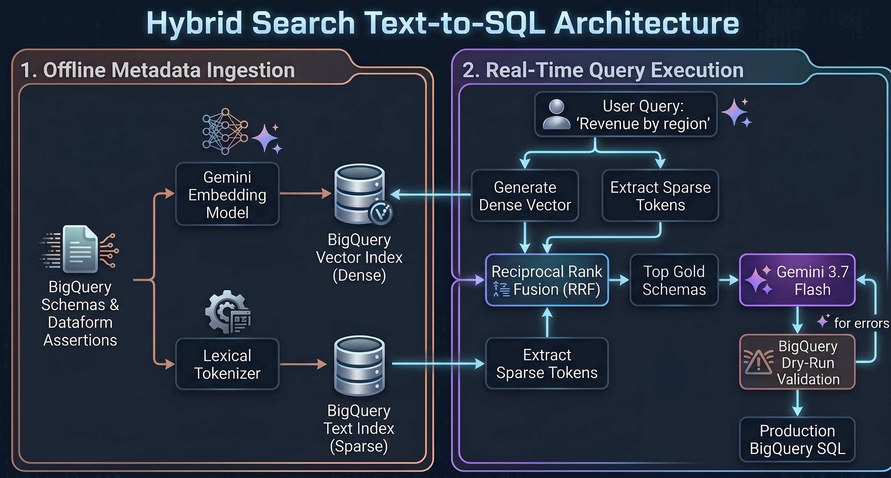
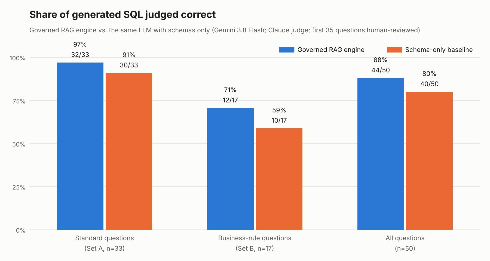
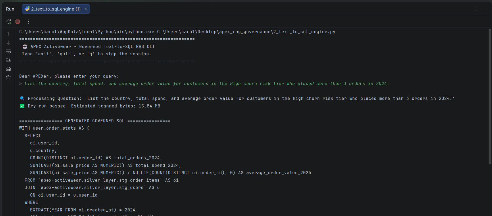
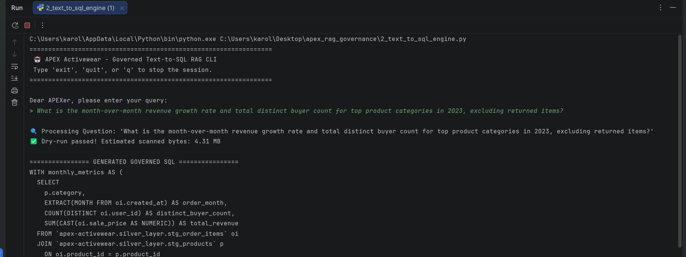

# Governed Text-to-SQL RAG Engine


Ask a business question in plain English and get BigQuery SQL that follows the company's certified tables and business rules, checked for errors and cost before anyone runs it.

## ⚠️ Business Problem

**APEX Activewear** is a simulated e-commerce warehouse (436K+ transactions, **$48.85M** realized revenue). An LLM pointed at raw schemas writes SQL that runs but can still be wrong:
* **Silent financial errors:** it sums gross sales without removing the **24% return rate**, so revenue is overstated.
* **Business jargon:** it cannot reliably map phrases such as "serial returners" to the right certified table.
* **Cost:** unoptimized SQL (fan-outs, full table scans) inflates the cloud bill.

## 💡 Solution

A **Retrieval-Augmented Generation (RAG)** engine, written as a Python CLI, that grounds Gemini in the warehouse's own documentation before it writes SQL.



* **Governance index:** table schemas (from live `INFORMATION_SCHEMA`), Dataform business rules and example queries are embedded with `gemini-embedding-001` into one BigQuery table.
* **Hybrid search in BigQuery:** `VECTOR_SEARCH` (meaning) plus text search (keywords), merged with Reciprocal Rank Fusion in Python. No external vector database.
* **Self-healing:** every query gets a free BigQuery dry-run; if it fails, the error goes back to the LLM to fix.
* **Human-in-the-loop:** queries above the scan-cost threshold (>500 MB) or below the LLM's confidence score (<0.85) pause for a person to approve, decline or edit.
* **Guardrails:** the model only sees certified `gold_layer` and selected `silver_layer` tables, and a hard check in code blocks any SQL that is not a single read-only `SELECT` on those datasets (no `DELETE`, `DROP` or raw tables). Blocked SQL goes back to the LLM to fix. Production would add database-level PII masking.

## 🏗️ Data Architecture

A **Dataform Medallion** pipeline: 6 raw sources, silver staging views with quality assertions (timeline checks, revenue status), and 10+ certified gold marts (RFM segments, cohort retention, fulfillment). The engine only uses the silver and gold layers, so joins follow validated paths.


## 📊 Evaluation

**Question:** does retrieving the company's own rules and tables produce more correct SQL than the same LLM (`gemini-3.8-flash`) given only the table schemas?



| 50 business questions | Engine | Schema-only baseline |
|---|---|---|
| Standard and search questions (33) | 32 | 30 |
| Questions with a hidden business rule (17) | 12 | 10 |
| **Correct SQL overall** | **44 (88%)** | **40 (80%)** |

**How a query is scored:** it must run in BigQuery, use the right tables, and match the logic of a reference query. A **Claude** model grades the logic with the same rules for both systems, so the grader is a different AI from the one writing the SQL.

**What it shows**
* **The engine wins where the rule is hidden.** Of the 4 questions only the engine got right, 3 depended on a rule the schemas don't show, such as "realized revenue" or "valid price". The baseline won none.
* **On simple questions the two nearly tie.** There are only 13 tables, and many questions name their table.
* **The gap is real but small.** 50 questions are too few to prove it statistically.
* **Results are stable.** Three runs of the first 35 questions gave 29, 28 and 28 correct for the engine, and 27 every time for the baseline.

<details>
<summary><b>🔎 How I checked the results, and what is still weak (click to expand)</b></summary>

**Checks**
* A second AI judge (Claude Opus) re-graded 28 verdicts and agreed with all of them.
* I reviewed 10 verdicts myself and overturned 3, where the question had more than one fair answer (for example, two valid ways to define margin). The last 15 questions were graded by the judge only.
* I compared the test questions with the engine's example queries and rewrote near-duplicates, so the engine can't simply look up the answers.
* I synced the baseline's schema file with the live warehouse, so both systems see the same tables.

**Weak spots**
* Small test: 50 questions. Three reference answers are disputed (`eval_03`, `eval_10`, `eval_b10`) because the metric has more than one fair definition.
* Ambiguous business terms have no single right answer.
* The "ask a human" rule is weak. It fired on 2 questions and caught 1 of 6 failures, because the AI's own confidence score is a poor signal. A better trigger is future work.

</details>

### 🏗️ Design Decisions
* **LLM judge vs. result-set equality:** comparing result sets fails queries that are correct but shaped differently (extra columns, other rounding). An LLM judges logic; table matching stays deterministic.
* **RAG vs. fine-tuning:** fine-tuning freezes the schema. Indexing live `INFORMATION_SCHEMA` keeps the engine current at no retraining cost.

## 🔍 Demos

### 🛡️ Cost control and self-healing
The engine catches a schema error, fixes it, then checks scan cost (15.68 MB) and confidence (0.92) before returning the SQL.

> *List the country, total spend, and average order value for customers in the High churn risk tier who placed more than 3 orders in 2024.*



<details>
<summary><b>🔍 View Validated Governed SQL</b></summary>

```sql
================ FINAL APPROVED SQL QUERY ================
WITH qualifying_users AS (
  SELECT
    oi.user_id,
    u.country,
    COUNT(DISTINCT oi.order_id) AS total_orders,
    SUM(CAST(oi.sale_price AS NUMERIC)) AS total_user_spend
  FROM `apex-activewear.silver_layer.stg_order_items` oi
  JOIN `apex-activewear.silver_layer.stg_users` u
    ON oi.user_id = u.user_id
  JOIN `apex-activewear.gold_layer.customer_churn_scores` cs
    ON oi.user_id = cs.user_id
  WHERE EXTRACT(YEAR FROM oi.created_at) = 2024
    AND oi.status NOT IN ('Returned', 'Cancelled')
    AND cs.is_churn_risk = TRUE
  GROUP BY oi.user_id, u.country
  HAVING COUNT(DISTINCT oi.order_id) > 3
)
SELECT
  country,
  ROUND(SUM(total_user_spend), 2) AS total_spend,
  ROUND(SAFE_DIVIDE(SUM(total_user_spend), SUM(total_orders)), 2) AS average_order_value
FROM qualifying_users
GROUP BY country
ORDER BY total_spend DESC;
==========================================================
```

</details>

### 📈 Window functions
Month-over-month growth with `LAG()` and CTEs, with returned items excluded by the retrieved business rule.

> *What is the month-over-month revenue growth rate and total distinct buyer count for top product categories in 2023, excluding returned items?*



<details>
<summary><b>🔍 View Governed SQL with Window Math</b></summary>

```sql
================ FINAL APPROVED SQL QUERY ================
WITH monthly_category_metrics AS (
  SELECT
    p.category,
    EXTRACT(MONTH FROM oi.created_at) AS order_month,
    COUNT(DISTINCT oi.user_id) AS distinct_buyers,
    SUM(CAST(oi.sale_price AS NUMERIC)) AS total_revenue
  FROM `apex-activewear.silver_layer.stg_order_items` oi
  JOIN `apex-activewear.silver_layer.stg_products` p
    ON oi.product_id = p.product_id
  WHERE EXTRACT(YEAR FROM oi.created_at) = 2023
    AND oi.status NOT IN ('Returned', 'Cancelled')
  GROUP BY p.category, order_month
),
mom_calculations AS (
  SELECT
    category,
    order_month,
    distinct_buyers,
    total_revenue,
    LAG(total_revenue) OVER (PARTITION BY category ORDER BY order_month) AS prev_month_revenue
  FROM monthly_category_metrics
)
SELECT
  category,
  order_month,
  total_revenue,
  distinct_buyers,
  ROUND(SAFE_DIVIDE(total_revenue - prev_month_revenue, prev_month_revenue) * 100, 2) AS mom_revenue_growth_pct
FROM mom_calculations
ORDER BY category, order_month;
==========================================================

```

</details>

## ⚙️ Repository & Quickstart

Code in `src/`, benchmark inputs in `data/`, run outputs in `results/`.

| Script | Purpose |
|---|---|
| `text_to_sql_engine.py` | The engine: hybrid search, Gemini generation, dry-run self-healing, human-in-the-loop |
| `01_check_schema_drift.py` | Checks the schema file matches the live warehouse |
| `02_validate_sql.py` | Dry-runs every reference and example query |
| `03_build_index.py` | Builds the governance index in BigQuery |
| `04_leakage_check.py` | Flags benchmark questions too close to the engine's examples |
| `05_run_baseline.py` | Runs and judges the schema-only baseline |
| `06_run_engine_evals.py` | Runs and judges the engine |
| `07_audit_judge.py` | Re-grades verdicts with a second judge model |
| `sql_guard.py` | Blocks anything that is not a read-only `SELECT` on certified tables |
| `test_sql_guard.py` | Tests the guard: unsafe SQL is blocked, all 54 reference queries still pass |
| `judge.py`, `eval_common.py` | Shared judge and scoring code |

```bash
pip install google-cloud-bigquery google-genai anthropic python-dotenv pandas scikit-learn db-dtypes pyarrow sqlglot
cd src
python test_sql_guard.py                        # safety check tests, no keys needed
python 03_build_index.py
python text_to_sql_engine.py                    # ask questions
python 06_run_engine_evals.py                   # Set A
python 06_run_engine_evals.py --eval-file ../data/eval_queries_set_b.json --out ../results/set_b_engine.json
```
Needs a `.env` with Google Cloud credentials and `CLAUDE_API_KEY`.
