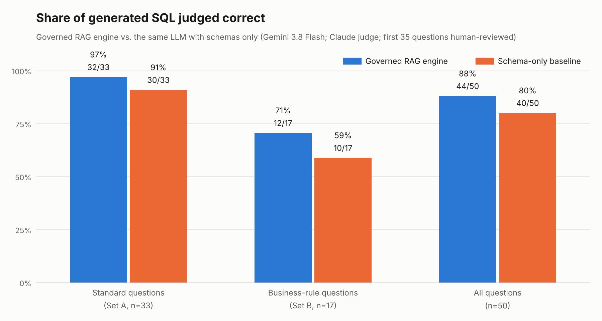

# Governed Text-to-SQL RAG Engine


Ask a business question in plain English and get BigQuery SQL that follows the company's certified tables and business rules, checked for errors and cost before anyone runs it.



**Result:** the engine wrote correct SQL for **88%** of 50 business questions, against **80%** for the same LLM given only the table schemas. The gap comes from business rules that column names don't reveal, such as excluding returned and cancelled orders from revenue. [Details below](#-evaluation).

## ⚠️ Business Problem

**APEX Activewear** is a simulated e-commerce warehouse (436K+ transactions, **$48.85M** realized revenue). An LLM pointed at raw schemas writes SQL that runs but can still be wrong:
* **Silent financial errors:** it sums gross sales without removing the **24% return rate**, so revenue is overstated.
* **Business jargon:** it cannot reliably map phrases such as "serial returners" to the right certified table.
* **Cost:** unoptimized SQL (fan-outs, full table scans) inflates the cloud bill.

## 💡 Solution

A **Retrieval-Augmented Generation (RAG)** engine, written as a Python CLI, that grounds Gemini in the warehouse's own documentation before it writes SQL.


* **Governance index:** table schemas (from live `INFORMATION_SCHEMA`), Dataform business rules and example queries are embedded with `gemini-embedding-001` into one BigQuery table.
* **Hybrid search in BigQuery:** `VECTOR_SEARCH` (meaning) plus text search (keywords), merged with Reciprocal Rank Fusion in Python. No external vector database.
* **Self-healing:** every query gets a free BigQuery dry-run; if it fails, the error goes back to the LLM to fix.
* **Human-in-the-loop:** queries above the scan-cost threshold (>500 MB) or below the LLM's confidence score (<0.85) pause for a person to approve, decline or edit.
* **Guardrails:** the model only sees certified `gold_layer` and selected `silver_layer` tables. This is prompt-level steering, not a hard block; production would add database-level PII masking.

## 🏗️ Data Architecture

A **Dataform Medallion** pipeline: 6 raw sources, silver staging views with quality assertions (timeline checks, revenue status), and 10+ certified gold marts (RFM segments, cohort retention, fulfillment). The engine only uses the silver and gold layers, so joins follow validated paths.


## 📊 Evaluation

**Question:** does governed retrieval produce more correct SQL than the same LLM (`gemini-3.8-flash`) given only the schemas?

| Questions | Engine | Schema-only baseline |
|---|---|---|
| Set A: standard and search (33) | 32 | 30 |
| Set B: hidden business rules (17) | 12 | 10 |
| **All (50)** | **44 (88%, 95% CI 76–94%)** | **40 (80%, 95% CI 67–89%)** |
| Judge only, before human review | 42 | 39 |

**How it was scored:** each query must pass a BigQuery dry-run, use the expected tables (exact name match), and match the logic of a reference query. A **Claude** model judges logic with one rubric for both systems, so the grader is from a different model family than the generator.

**What it shows:**
* **On standard questions the plain LLM nearly ties the engine.** 13 tables fit in one prompt, and many questions name their table.
* **The engine wins where the rule is hidden.** Of the 4 questions only the engine got right, 3 needed a rule the baseline missed, such as realized revenue or valid price. In the fourth the baseline picked a pre-aggregated mart instead of the staging tables. The baseline won none.
* **Not statistically proven.** 4 wins to 0 gives p ≈ 0.12, and the intervals overlap. 50 questions are too few to prove the gap.
* **Stable across runs:** on the first 35 questions the engine scored 29, 28 and 28 over three runs, the baseline 27 each time (judge verdicts before review). The last 15 questions were run once.

**How the results were checked:**
* **Second judge:** Claude Opus re-graded 28 verdicts and agreed with all of them. Same vendor, so this checks consistency, not truth.
* **Human review:** I reviewed 10 verdicts on the first 35 questions and overturned 3 (a valid alternative margin definition; an ambiguous question with several defensible answers). The last 15 questions are judge-only. Both versions are in the table.
* **Leakage check:** benchmark questions were compared with the engine's example queries; near-duplicates were rewritten.
* **Schema drift check:** the baseline's schema file was synced with the live warehouse, so both systems see the same tables.

**Limitations:**
* Small benchmark; three reference queries are disputed (eval_03, eval_10, eval_b10) because the metric has more than one fair definition.
* Ambiguous jargon has no single right answer.
* **The escalation rule is weak:** it fired on 2 questions and caught 1 of 6 failures. LLM self-rated confidence is a poor signal; a better trigger is future work.

### 🏗️ Design Decisions
* **LLM judge vs. result-set equality:** comparing result sets fails queries that are correct but shaped differently (extra columns, other rounding). An LLM judges logic; table matching stays deterministic.
* **RAG vs. fine-tuning:** fine-tuning freezes the schema. Indexing live `INFORMATION_SCHEMA` keeps the engine current at no retraining cost.

## 🔍 Demos

### 🛡️ Cost control and self-healing
The engine catches a schema error, fixes it, then checks scan cost (15.68 MB) and confidence (0.92) before returning the SQL.

> *List the country, total spend, and average order value for customers in the High churn risk tier who placed more than 3 orders in 2024.*


<details>
<summary><b>🔍 View Validated Governed SQL</b></summary>

```sql
================ FINAL APPROVED SQL QUERY ================
WITH qualifying_users AS (
  SELECT
    oi.user_id,
    u.country,
    COUNT(DISTINCT oi.order_id) AS total_orders,
    SUM(CAST(oi.sale_price AS NUMERIC)) AS total_user_spend
  FROM `apex-activewear.silver_layer.stg_order_items` oi
  JOIN `apex-activewear.silver_layer.stg_users` u
    ON oi.user_id = u.user_id
  JOIN `apex-activewear.gold_layer.customer_churn_scores` cs
    ON oi.user_id = cs.user_id
  WHERE EXTRACT(YEAR FROM oi.created_at) = 2024
    AND oi.status NOT IN ('Returned', 'Cancelled')
    AND cs.is_churn_risk = TRUE
  GROUP BY oi.user_id, u.country
  HAVING COUNT(DISTINCT oi.order_id) > 3
)
SELECT
  country,
  ROUND(SUM(total_user_spend), 2) AS total_spend,
  ROUND(SAFE_DIVIDE(SUM(total_user_spend), SUM(total_orders)), 2) AS average_order_value
FROM qualifying_users
GROUP BY country
ORDER BY total_spend DESC;
==========================================================
```

</details>

### 📈 Window functions
Month-over-month growth with `LAG()` and CTEs, with returned items excluded by the retrieved business rule.

> *What is the month-over-month revenue growth rate and total distinct buyer count for top product categories in 2023, excluding returned items?*


<details>
<summary><b>🔍 View Governed SQL with Window Math</b></summary>

```sql
================ FINAL APPROVED SQL QUERY ================
WITH monthly_category_metrics AS (
  SELECT
    p.category,
    EXTRACT(MONTH FROM oi.created_at) AS order_month,
    COUNT(DISTINCT oi.user_id) AS distinct_buyers,
    SUM(CAST(oi.sale_price AS NUMERIC)) AS total_revenue
  FROM `apex-activewear.silver_layer.stg_order_items` oi
  JOIN `apex-activewear.silver_layer.stg_products` p
    ON oi.product_id = p.product_id
  WHERE EXTRACT(YEAR FROM oi.created_at) = 2023
    AND oi.status NOT IN ('Returned', 'Cancelled')
  GROUP BY p.category, order_month
),
mom_calculations AS (
  SELECT
    category,
    order_month,
    distinct_buyers,
    total_revenue,
    LAG(total_revenue) OVER (PARTITION BY category ORDER BY order_month) AS prev_month_revenue
  FROM monthly_category_metrics
)
SELECT
  category,
  order_month,
  total_revenue,
  distinct_buyers,
  ROUND(SAFE_DIVIDE(total_revenue - prev_month_revenue, prev_month_revenue) * 100, 2) AS mom_revenue_growth_pct
FROM mom_calculations
ORDER BY category, order_month;
==========================================================

```

</details>

## ⚙️ Repository & Quickstart

Code in `src/`, benchmark inputs in `data/`, run outputs in `results/`.

| Script | Purpose |
|---|---|
| `text_to_sql_engine.py` | The engine: hybrid search, Gemini generation, dry-run self-healing, human-in-the-loop |
| `01_check_schema_drift.py` | Checks the schema file matches the live warehouse |
| `02_validate_sql.py` | Dry-runs every reference and example query |
| `03_build_index.py` | Builds the governance index in BigQuery |
| `04_leakage_check.py` | Flags benchmark questions too close to the engine's examples |
| `05_run_baseline.py` | Runs and judges the schema-only baseline |
| `06_run_engine_evals.py` | Runs and judges the engine |
| `07_audit_judge.py` | Re-grades verdicts with a second judge model |
| `judge.py`, `eval_common.py` | Shared judge and scoring code |

```bash
pip install google-cloud-bigquery google-genai anthropic python-dotenv pandas scikit-learn db-dtypes pyarrow
cd src
python 03_build_index.py
python text_to_sql_engine.py                    # ask questions
python 06_run_engine_evals.py                   # Set A
python 06_run_engine_evals.py --eval-file ../data/eval_queries_set_b.json --out ../results/set_b_engine.json
```
Needs a `.env` with Google Cloud credentials and `CLAUDE_API_KEY`.
